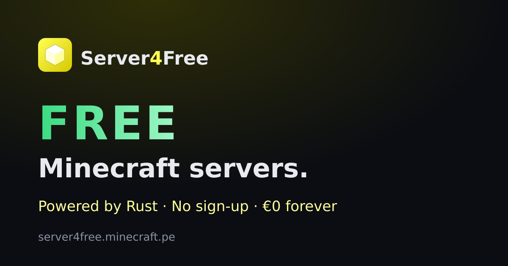

# Server4Free

**Free Minecraft server hosting. No sign-up, no credit card, no trial – just click and play.**

 

## What is Server4Free?

Server4Free gives everyone their own **Minecraft Java server in seconds** – completely free and without creating an account.

Press one button and your server is online with its own address. Copy it, open Minecraft, add the server and play with your friends.

 

## Features

- **One click** – no email, no password, no credit card
- **Starts in about one second** – powered by [Pumpkin](https://github.com/Pumpkin-MC/Pumpkin), a blazingly fast Minecraft server written in Rust
- **Your own address** – every server gets its own IP and port
- **Live console** – watch your server log and run commands right in the browser
- **Start, stop, restart** – full control from a simple web panel
- **Server settings** – change the important options without touching files
- **Public server list** – show off your server and find others to join
- **Free forever** – not per month, not after a trial, just free

 

## How it works

1. Open **[server4free.minecraft.pe](https://server4free.minecraft.pe)**
2. Click **"Get your FREE server"**
3. Copy your server address
4. In Minecraft: **Multiplayer → Add Server** → paste the address
5. Invite your friends and play

 

## Built with

 

## About this repository

This repository is the public home of Server4Free. The platform itself is **closed source** – you'll find information, updates and a place for feedback here.

Found a bug or have an idea? **[Open an issue](../../issues)** – feedback is very welcome.

 

---

Made by **[Ashalinux](https://github.com/Ashalinux)** · Also check out **[Gensky.online](https://github.com/Ashalinux/gensky)**, a German generator Skyblock server.
